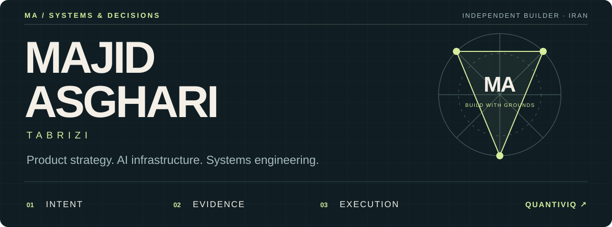
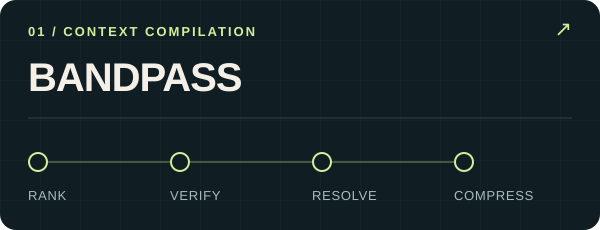
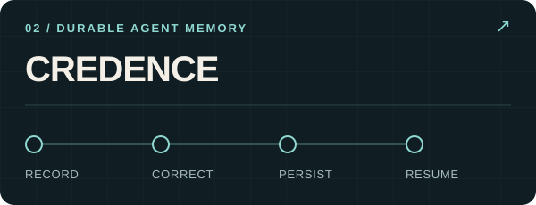
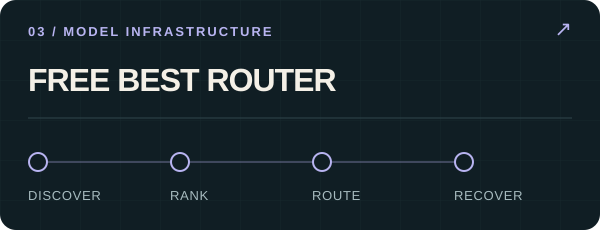
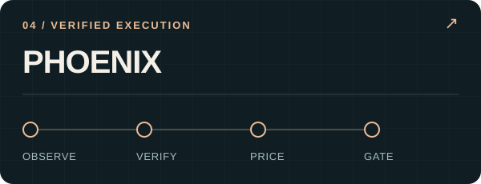
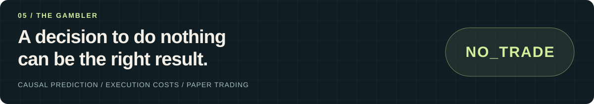

  

  <a href="https://quantiviq.xyz/profile"><strong>Portfolio</strong></a> &nbsp; / &nbsp;
  <a href="https://quantiviq.xyz">Quantiviq</a> &nbsp; / &nbsp;
  <a href="https://www.linkedin.com/in/majid-asghari/">LinkedIn</a> &nbsp; / &nbsp;
  <a href="mailto:majid@quantiviq.xyz">Let's talk</a>

# I build systems that can explain their decisions.

I'm **Majid Asghari Tabrizi**, a product strategist and AI systems builder based in Iran, and the founder of **[Quantiviq](https://quantiviq.xyz)**. I connect product judgment with the infrastructure behind it: what an agent knows, which model it calls, what it can do, and how it recovers.

My work follows one thread: **make evidence, uncertainty, and failure part of the design.**

## Selected systems

<table>
<tr>
<td width="50%" valign="top">

### [Bandpass](https://github.com/MajidAsghariTabrizi/bandpass)

**Give agents better grounds.** Compiles memory, files, state, and evidence into a compact, inspectable Context Capsule over MCP.

TypeScript · MCP · Context engineering

[Try the interactive lab ↗](https://majidasgharitabrizi.github.io/bandpass/) · [Read the architecture](https://github.com/MajidAsghariTabrizi/bandpass/blob/main/docs/ARCHITECTURE.md)

</td>
<td width="50%" valign="top">

### [Credence](https://github.com/MajidAsghariTabrizi/credence)

**The process ends. The mission continues.** Evidence-linked agent memory, explicit unknowns, immutable belief history, and missions that resume from durable state.

TypeScript · Agent memory · Durable execution

[Run the kill-and-resume demo ↗](https://github.com/MajidAsghariTabrizi/credence#kill-the-agent-the-mission-continues)

</td>
</tr>
<tr>
<td width="50%" valign="top">

### [Free Best Router](https://github.com/MajidAsghariTabrizi/free-best-router)

**One endpoint. A changing model landscape.** Discovers and ranks free AI models, checks their health, and routes requests with bounded failover and cooldowns.

JavaScript · Model routing · Self-hosted

[Get started ↗](https://github.com/MajidAsghariTabrizi/free-best-router#quick-start-60-seconds)

</td>
<td width="50%" valign="top">

### [Phoenix](https://github.com/MajidAsghariTabrizi/anti-gravity-phoenix-v4)

**Execution has to earn permission.** Arbitrum financial infrastructure with independent state verification, conservative economics, and fail-closed transaction gates.

Rust · Arbitrum · Financial infrastructure

[Explore the system ↗](https://github.com/MajidAsghariTabrizi/anti-gravity-phoenix-v4#system-overview)

</td>
</tr>
</table>

## Research with an honest answer

**[The Gambler](https://github.com/MajidAsghariTabrizi/the-gambler-trading-lab)** is my Python research lab for causal prediction, realistic execution costs, paper trading, and governed learning. Its published findings report that none of the evaluated signals cleared the execution-cost hurdle. The negative result is part of the work.

[Findings and evidence ↗](https://github.com/MajidAsghariTabrizi/the-gambler-trading-lab/blob/master/docs/research/ATLAS.md) · [Reproducible cost fixture](https://github.com/MajidAsghariTabrizi/the-gambler-trading-lab/blob/master/docs/execution/COST_MATH.md)

## How I build

**Start with the decision.** Define the user, constraints, and economics before the architecture. 
**Keep the evidence.** Preserve provenance, corrections, and unknowns. 
**Design the recovery.** Bound retries, make authority explicit, and keep state durable. 
**Make the work inspectable.** Ship runnable demos, clear limitations, and reproducible checks.

Also building **[Universal Engineering Agent](https://github.com/MajidAsghariTabrizi/universal-engineering-agent)**: a vendor-independent reference kernel for inspecting, planning, verifying, and recovering engineering work.

---

**Working on AI-native organizations or agent infrastructure?** 
[Explore Quantiviq](https://quantiviq.xyz) · [See my engineering work](https://quantiviq.xyz/profile) · [Get in touch](mailto:majid@quantiviq.xyz)
